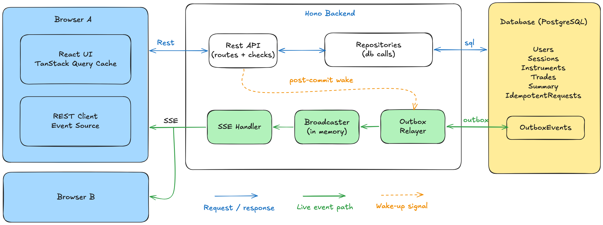

# Trade Blotter

A USD equities workspace for recording trades, following live changes and viewing
current desk positions. Built with React, TypeScript, Vite, Tailwind, AG Grid,
TanStack Query, Hono, Zod, Prisma and PostgreSQL.

[Open the application](https://app.teng.website) · [Demo accounts](#demo-accounts)

## Scope

- Individual trader and read-only accounts; traders amend/cancel only their own ACTIVE trades.
- Server-side sorting/filtering, cursor pages, creation, amendments and cancellations.
- Live trade and position updates over SSE with a transactional outbox.
- Append-only audit history, a history view and a Position Summary tab.
- Structured logging, automated tests and CI. P&L remains deferred.

## Architecture decisions



Hono, React/Vite and pnpm were chosen for familiarity. PostgreSQL was also familiar
and provides the relational constraints and ACID transactions this workflow needs.

- **React + Vite:** AG Grid renders trades; TanStack Query manages fetched data
  and live cache updates. The application runs in the browser.
- **Hono + TypeScript:** feature repositories separate database access from HTTP
  handling. Zod validates request and response contracts.
- **PostgreSQL + Prisma:** trade changes, audit entries, position totals and outbox
  events commit together. Creation also saves its idempotency response.
- **REST + SSE:** REST handles commands and queries; SSE pushes committed trade
  and position snapshots. Entity versions guard against duplicate/older updates.
  Reconnects fetch fresh snapshots.
- **Database sessions:** HttpOnly cookies identify individual accounts; the backend
  checks expiry, current roles and trade ownership.

See [Technical Design](docs/technical-design.md) for the complete flows.

## Run locally

Requires Node **24.14.0**, pnpm **12.11.2** and Docker with Compose.

```sh
git clone https://github.com/tengbesabe22/trade-blotter.git
cd trade-blotter
pnpm install --frozen-lockfile
cp backend/.env.example backend/.env
cp database/.env.example database/.env
pnpm db:up
pnpm db:migrate:dev
pnpm db:seed
```

Use `Copy-Item` instead of `cp` in PowerShell. Start the API:

```sh
pnpm dev
```

Start the frontend in another terminal:

```sh
pnpm --filter @trade-blotter/frontend dev
```

Open **http://localhost:5173**. The API runs at **http://localhost:3000** and
PostgreSQL at **localhost:5432**. Vite proxies `/api`; leave `VITE_API_ORIGIN` unset
for local development. Port 5173 must be available.

To run the API in Docker after the same database setup, use this in place of
`pnpm dev`; keep the frontend running through Vite:

```sh
docker compose up --build -d --wait
```

A fresh seed creates 10 instruments, four accounts, 500 synthetic trades, their
audit histories and 10 position summaries. Reruns preserve existing data. The
named Docker volume retains PostgreSQL data across container restarts.

### Configuration

| Variable | Location / purpose |
| --- | --- |
| `DATABASE_URL` | `backend/.env` and `database/.env`; both target the intended PostgreSQL database. |
| `APP_ORIGIN` | Backend; exact allowed browser origin, default `http://localhost:5173`. |
| `VITE_API_ORIGIN` | Frontend build; unset uses local `/api`; deployment uses `https://api.teng.website`. |
| `PORT` | Backend; default `3000`. |
| `LOG_LEVEL` | Backend JSON logging; default `info`, `debug` adds delivery records. |
| `NODE_ENV` | `production` enables Secure cookies and requires HTTPS `APP_ORIGIN`. |

## Demo accounts

All use the demo password **`LocalDemo!2026`**. Trades and prices are fictional.

| Email | Role |
| --- | --- |
| `jsmith@example.com` | Trader |
| `adoe@example.com` | Trader |
| `mlee@example.com` | Trader |
| `reviewer@example.com` | Read-only |

Use separate browser profiles or normal/private windows for two accounts; ordinary
tabs share cookies. Create/amend/cancel in one and observe updates in the other.

## Checks and build

Run from the repository root, in this order:

```sh
pnpm typecheck
pnpm test
pnpm build
pnpm --filter @trade-blotter/frontend lint
pnpm --filter @trade-blotter/frontend build
```

`pnpm typecheck` builds the database package needed by backend imports. Tests cover
validation, domain rules, repositories, HTTP routes and frontend/cache interactions,
using fakes for database access; a running PostgreSQL instance is not required.
GitHub Actions runs these checks on main pushes, pull requests and manual dispatch.

`pnpm build` builds the database package and API; `pnpm start` runs the built API.
The separate frontend build produces `frontend/dist`.

| Database command | Purpose |
| --- | --- |
| `pnpm db:logs` | Follow PostgreSQL logs. |
| `pnpm db:down` | Stop Compose containers and retain their volumes. |
| `pnpm db:validate` | Validate the Prisma schema. |
| `pnpm db:migrate:create --name change_name` | Generate a migration for review without applying it. |
| `pnpm db:migrate:dev` | Apply local development migrations. |
| `pnpm db:seed` | Seed synthetic data. |
| `pnpm db:studio` | Inspect the database. |

## Assumptions

- Instruments are seeded USD equities; instrument administration and external
  market-data feeds are outside the current scope.
- Traders can view all trades but amend/cancel only their own ACTIVE trades.
  Read-only accounts can inspect trades, history and positions.
- CANCELLED is terminal: a cancelled trade cannot be amended or restored. The
  trade and its audit history are retained.
- The instrument is immutable after creation; correcting it requires cancellation
  and a new trade.
- Execution times and date filters use UTC. The blotter includes all dates unless
  filtered. Position Summary covers ACTIVE trades across all traders, books and
  dates, assumes zero opening balances and is independent of blotter filters.
- Deployment uses one API instance because live broadcasting is process-local.
  P&L and historical valuations remain deferred.

## Accepted trade-offs

| Choice | Benefit | Accepted cost |
| --- | --- | --- |
| REST + SSE with full snapshots | Native one-way streaming and independent version checks. | Larger events; client commands use REST. |
| In-process outbox delivery | Durable events without another service. | Fan-out is local; a missed wake waits for another trade or restart. Publication is not browser acknowledgement. |
| Fresh snapshots on reconnect | Simple current-state recovery. | Missed transitions are inspected through audit history rather than stream replay. |
| Server filtering/sorting with cursor pages | Bounded transfers as history grows. | Navigation needs requests; some live changes need a batched page fetch. Previous uses frontend cursor history. |
| Stored position totals | Fast summary reads. | Extra mutation writes and possible contention on busy symbols. |
| Database sessions | Straightforward logout and current permission checks. | Protected requests depend on database lookups. Federation remains production work. |

Lookup lists and per-trade history load in full; history refreshes manually.
Isolated tests do not establish live-database concurrency or production capacity.
See [Decisions and Scaling](docs/decisions.md) for limits and the production path.

## Deployment

Frontend: [Vercel](https://app.teng.website). API: Lightsail/Caddy at
`api.teng.website`. Database: Neon. Backend deployment is manual; CI verifies code.
See [Deployment](docs/deployment.md) for configuration and commands.

## Documentation

| Guide | Read for |
| --- | --- |
| [Technical Design](docs/technical-design.md) | Architecture, authentication, schema, API contracts and trade flows. |
| [Frontend Overview](docs/frontend.md) | Screen structure, state ownership, data flow and recovery. |
| [Real-time Updates](docs/realtime.md) | Event delivery, frontend merging and reconnect recovery. |
| [Decisions and Scaling](docs/decisions.md) | Alternatives, accepted limits and the production path. |
| [Deployment](docs/deployment.md) | Hosting services, configuration, Caddy and deployment commands. |
| [AI Usage](docs/ai-usage-report.md) | Tools, developer/AI contributions, decisions and the significant-prompt log. |
