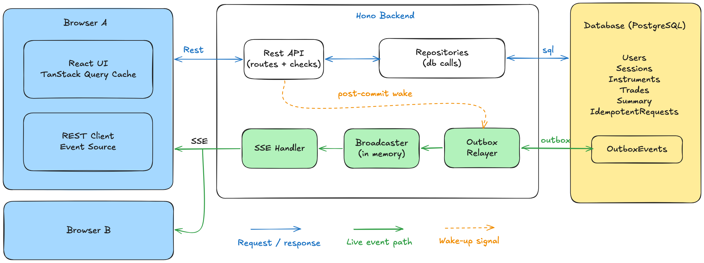
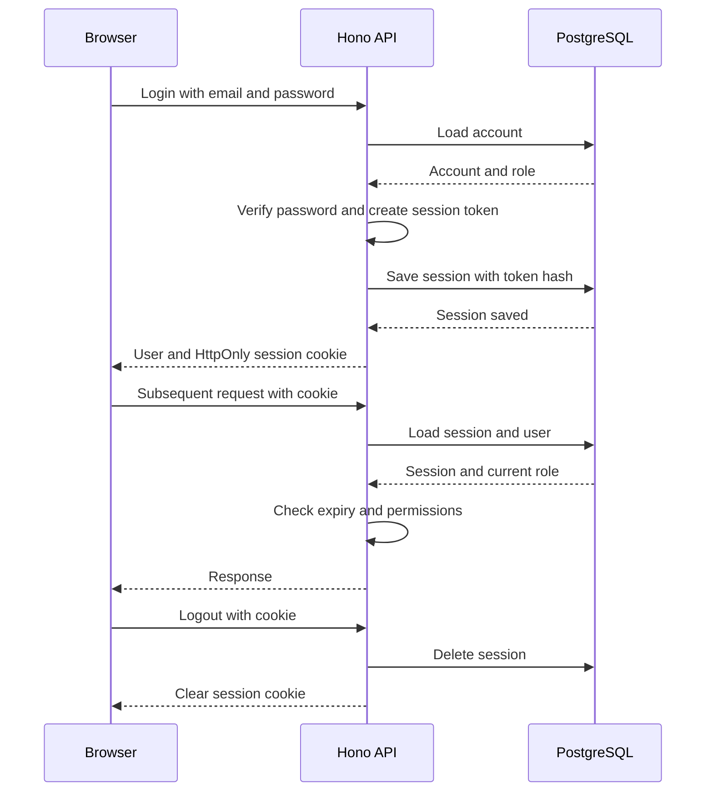

# Technical Design

[Architecture](#architecture) · [Authentication](#authentication) · [Database](#database) ·
[API](#api-conventions) · [Listing](#trade-listing) · [Creation](#trade-creation) ·
[Amend/cancel](#trade-amendments-and-cancellation) · [Audit](#audit-history) ·
[Positions](#position-summary) · [Diagnostics/tests](#diagnostics-and-testing)

## Architecture



Overview of the current single-instance backend.

- **Frontend:** React, TypeScript, AG Grid and TanStack Query. Trades and Position
  Summary have separate tabs; create, amend and cancel share one action panel.
- **Backend:** one Node.js/Hono process handles authentication, trade requests,
  outbox delivery and SSE connections. Repositories separate database access
  from HTTP handling.
- **Database:** PostgreSQL stores business data and sessions; Prisma manages
  typed database access and migrations.
- **Validation:** Zod provides runtime validation and inferred TypeScript types for API contracts.

REST handles requests and mutations. SSE pushes committed trade and position
updates to connected clients. Delivery does not block the mutation response.
See [Real-time Updates](realtime.md) for delivery/reconnection and
[Decisions and Scaling](decisions.md) for limits and production plans.

## Authentication



Passwords use individually salted hashes. Login creates a random session token;
the browser receives it in an HttpOnly cookie and PostgreSQL stores only its hash.
The frontend does not store tokens in local storage. This is a database-session
model, without separate access/refresh tokens.

| Policy | Behavior |
| --- | --- |
| Session lifetime | Maximum 8 hours; expires after 5 minutes without user activity. |
| Background activity | SSE, lookups and automatic snapshot reads do not extend idle time. |
| Browser restoration | One `/me` request on startup restores the signed-in user; no polling. |
| Browser protection | SameSite cookie, HTTPS/Secure cookie in production, trusted Origin for mutations. |
| Logout | Removes the database session; subsequent validation rejects it. Open SSE connections recheck sessions before events and on heartbeats. |

| Role | Permissions |
| --- | --- |
| TRADER | View all trades/history/positions; create trades; amend/cancel own ACTIVE trades. |
| READ_ONLY | View all trades/history/positions and receive live updates; no mutations. |

The backend enforces permissions even when the UI hides unavailable actions.
Federation and shared rate limiting are [production work](decisions.md#production-path).

## Database

### Data model

| Table | Responsibility |
| --- | --- |
| Instrument | Seeded USD equities available for trading. |
| User | Individual account, role and ownership of trades. |
| Session | User session, token hash, activity and expiry. |
| Trade | Current state of one execution, linked to its owner and instrument. |
| TradeAudit | Append-only history of successful trade changes and their actors. |
| SymbolSummary | Current ACTIVE-trade totals per instrument across the desk. |
| OutboxEvent | Saved trade/summary event and its delivery/retry state. |
| IdempotencyRequest | Original creation response and request identity for safe retries. |

The [schema](../database/prisma/schema.prisma) defines fields and relationships;
[migrations](../database/prisma/migrations) also contain database checks and
append-only audit enforcement.

### Integrity and transactions

- Exact decimals preserve quantities and prices; the API sends them as strings.
  Quantity supports six decimal places and price four; excess precision is rejected.
- Timestamps represent UTC instants. Execution time and recording time are distinct.
- Foreign keys preserve relationships. Unique rules prevent duplicate instruments,
  accounts, idempotency keys per user, summaries per instrument and audit/outbox
  entries per trade version.
- Trade changes, audit history, affected summaries and the outbox commit together.
  Creation also saves its idempotency response. Failure rolls back all related writes.
- Audit history is append-only. Outbox delivery status remains mutable because
  publication and retries happen after commit.

### Indexes

Indexes support trader/instrument filtering, newest-first trade pages, session
validation, per-trade history and pending outbox delivery. The trade-date/ID index
supports the default ordering without a separate sort in the observed local plan.
That query-plan check is not a capacity benchmark.

### Migrations and seed

Migrations define the database structure and SQL protections. Review generated SQL
before applying it; seeding is a separate operation. Commands are in the
[README](../README.md#checks-and-build).

A fresh seed supplies 10 instruments, four demo accounts, 500 synthetic trades,
their audit histories and initial summaries. Reruns preserve existing records;
the seed is not a repair tool. Sessions, delivery events and idempotency responses
are not seeded. Demo credentials are in the [README](../README.md#demo-accounts).

## API Conventions

Requests and responses have typed contracts with runtime validation. Inputs are
normalized before storage: symbols are standardized, text is trimmed and dates
become UTC. Unknown request fields and invalid values are rejected.

Public trade responses contain symbol, trader, owner, execution details, status
and version. Decimal amounts are strings; timestamps are UTC. Account credentials
and internal database relations are excluded. `schemaVersion` identifies the
response format; `trade.version` identifies a trade revision.

### Endpoints

| Area | Endpoints |
| --- | --- |
| Health | `GET /api/health` |
| Authentication | `POST /api/auth/login`, `GET /api/auth/me`, `POST /api/auth/logout` |
| Blotter | `GET /api/trades`, `GET /api/trades/filter-options` |
| Creation | `POST /api/trades` |
| Amendment | `PATCH /api/trades/:id` |
| Cancellation | `POST /api/trades/:id/cancel` |
| History | `GET /api/trades/:id/history` |
| Positions | `GET /api/summaries` |
| Live updates | `GET /api/events` — [event contract](realtime.md#event-contract) |

Business endpoints require a valid session; mutations also enforce trader role,
trusted Origin, JSON and bounded request size. Successful trade mutations return
`{trade}`. Creation returns 201, including safe replays of the original result.

Errors use `{code,message}`. Invalid input returns 400, missing/expired sessions
401, forbidden actions 403, missing trades 404 and concurrency/idempotency conflicts
409. Stale-trade conflicts also include the current trade so the user can review it.
Oversized/unsupported bodies return 413/415; unexpected failures return a sanitized
500 response. Authenticated responses are not stored in HTTP caches.

## Trade Listing

Sorting and filtering happen on the server. Each request returns a bounded page:
100 trades by default, at most 200, newest execution first. ID breaks sorting ties.
The UI shows the loaded count rather than an exact matching total.

| Control | Behavior |
| --- | --- |
| Ticker, trader, status, side | Exact selection; All removes that filter. |
| Book, counterparty | Partial, case-insensitive matching. |
| Trade dates | From/Through cover whole UTC days. |
| Sorting | Execution time, symbol, trader, quantity, price or status; ascending/descending. |

The API returns a cursor for the next page. The frontend remembers earlier cursors
for Previous navigation; changing filters, sorting or page size returns to page one.
Pages reflect current data rather than a frozen historical snapshot.

Text/date filters apply together. Instrument/trader lookups share a frontend cache
across creation and filtering. The grid displays the server result; live updates
merge into it, with bounded reconciliation when ordering or membership changes.
See [live page handling](realtime.md#frontend-processing).

## Trade Creation

```text
Validate request → check safe retry → save trade and related records
                → respond to caller + wake live delivery
```

A trader selects an instrument and supplies side, quantity, price, execution time
and optional book/counterparty. Each submission includes an idempotency key.

The same user/key with the same normalized request returns the original result;
reusing it with different input returns a conflict. Concurrent identical submissions
produce one committed trade. An uncertain network outcome retains the original
key/input so retrying cannot create a duplicate.

## Trade Amendments and Cancellation

Only the owner can change an ACTIVE trade. Each request supplies the version the
user reviewed. The database accepts the change only if that version is still current,
then advances it. Concurrent edits cannot silently overwrite each other.

| Action | Behavior |
| --- | --- |
| Amend | Change side, quantity, price, execution time, book or counterparty. Omitted fields remain unchanged; null/blank metadata clears it. No-op changes are rejected. |
| Cancel | Mark CANCELLED; retain the row and history. Cancelled trades cannot be amended or restored. |
| Both | Optional reason; stale requests return the current trade for explicit review. |

The instrument is immutable after creation. A wrong symbol requires cancel + create;
those are separate operations.

The action panel preserves drafts during live updates and asks the user to review
newer data before saving. Successful responses update the caller immediately; SSE
updates other clients. Only committed changes trigger delivery.

## Audit History

Creation, amendment and cancellation each save the resulting trade snapshot, actor,
version, time and optional reason. Drafts, rejected requests and creation replays
produce no additional history.

Both roles can inspect any trade's history in a separate view, newest first, with
changed fields highlighted. History refreshes manually and currently returns the
whole per-trade history. Global audit search is deferred.

## Position Summary

The Position Summary shows current desk-wide bought, sold and net quantities per
symbol, with Long/Short/Flat direction. It covers ACTIVE trades across all traders,
books and dates, assumes zero opening balances and is independent of blotter filters.

Totals are maintained in the same transaction as trade changes. Amendments apply
the difference; cancellation removes that trade's contribution. For example,
amending BUY 10 to BUY 12 adds two units; cancelling it removes twelve.

The server pushes the resulting summary snapshot with the trade event. Independent
summary versions prevent duplicate or older events from replacing newer totals.
Reconnection reloads the current baseline. See [live cache behavior](realtime.md#frontend-processing).
P&L, market valuation and historical positions remain deferred.

## Diagnostics and Testing

### Logging

Structured JSON logs cover HTTP outcomes, outbox failures/retries and SSE lifecycle.
Request, connection and change identifiers connect related logs. Credentials,
session tokens, identities and financial payloads are excluded from these logs.

Server timing does not prove browser receipt or end-to-end latency. Client
p50/p95/p99 measurements and deployment verification remain pending.

### Testing

Automated tests cover validation, permissions, trade mutations, exact calculations,
audit behavior, delivery/retries and frontend/cache interactions. Database operations
are faked; the suite does not prove PostgreSQL concurrency, rollback or production
capacity. CI runs type checks, tests, builds and frontend lint without a live database.
See [validation commands](../README.md#checks-and-build).
